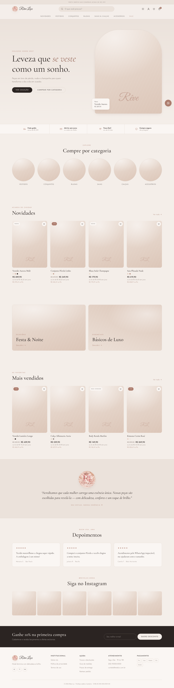

# Rêve Lux · Moda Feminina

Loja virtual da Rêve Lux em HTML, CSS e JS puro, sem build. Tem catálogo, página de produto, busca, sacola, favoritos e painel de admin, pronta para ligar ao Supabase.

> *Seu estilo, nossa essência ♡*

## Como rodar
Abra o `index.html` no navegador, ou sirva a pasta:
```bash
python3 -m http.server 8080
```
Também funciona direto no **GitHub Pages** (Settings → Pages → branch → `/root`).

## Páginas
| Página | O que faz |
|---|---|
| `index.html` | Home: carrossel, categorias, vitrines Novidades e Mais vendidos, Instagram |
| `catalogo.html` | Catálogo com busca (`?q=`), categoria (`?cat=`), favoritos (`?fav=1`) e ordenação |
| `produto.html?id=…` | Produto: galeria, cor, tamanho, quantidade, sacola, favorito, descrição e relacionados |
| `admin.html` | Painel do lojista: login, lista, cadastro, edição, fotos e exclusão de produtos |

## Estrutura
```
assets/js/config.js    # Chaves do Supabase (vazio = modo demonstração)
assets/js/data.js      # Categorias e catálogo de exemplo
assets/js/store.js     # Camada de dados: produtos, sacola, favoritos, login (Supabase ou localStorage)
assets/js/layout.js    # Cabeçalho, rodapé, tema, sacola lateral, card de produto
assets/js/main.js      # Home (vitrines, âncoras, carrossel)
assets/js/catalogo.js  # Busca e filtros
assets/js/produto.js   # Página de produto
assets/js/admin.js     # Painel
assets/css/style.css   # Tokens, temas e layout da loja
assets/css/admin.css   # Layout do painel
supabase/schema.sql    # Tabelas, RLS e storage
supabase/seed.sql      # Produtos de exemplo
docs/BANCO-DE-DADOS.md # Por que Supabase, segurança e como configurar
docs/ARQUITETURA.md    # Mapa das seções
docs/PROMPTS-HERO.md   # Prompts das imagens do carrossel
```

## Banco de dados
Está preparado para **Supabase**. Sem configuração, roda em modo demonstração, salvando tudo no navegador.
Login de teste do painel: `admin@revelux.com` / `revelux123`. Passo a passo em [docs/BANCO-DE-DADOS.md](docs/BANCO-DE-DADOS.md).

## Identidade visual
| Token | Claro | Escuro | Uso |
|---|---|---|---|
| `--bg` | `#f4eee9` pérola | `#16120f` | fundo |
| `--surface-2` | `#ebe2db` marfim | `#261f1b` | faixas e áreas de apoio |
| `--text` | `#2b2422` | `#f2e9e4` | texto |
| `--accent` | `#ad7d6e` rosé-gold suave | `#d4a998` | detalhes, preços no Pix, selos |

Tipografia: **Great Vibes** (script, como no logo), **Cormorant Garamond** (títulos) e **Jost** (texto e interface).
O rosa forte do logo virou um rosé-gold discreto, usado só como acento sobre uma base branca e pérola.

## Tema claro/escuro
- Segue o `prefers-color-scheme` do sistema e pode ser trocado pelo botão de sol/lua no header.
- A escolha fica salva no `localStorage` (`rl-theme`).
- A troca tem transição suave (`--t: .45s`) em fundo, texto, bordas e sombras.
- `prefers-reduced-motion` desliga as animações.

## O que funciona
- Busca pelo cabeçalho, filtros por categoria e ordenação por preço ou nome
- Página de produto com escolha de cor, tamanho e quantidade, validação e produtos relacionados
- Sacola lateral com quantidade, remoção, subtotal e aviso de frete grátis (salva no navegador)
- Favoritos com contador no cabeçalho e lista própria
- Painel: cadastrar, editar e excluir produtos, enviar fotos, cores, tamanhos, estoque e visibilidade

**Ainda falta:** pagamento (checkout) e conta da cliente. O roteiro está em `docs/BANCO-DE-DADOS.md`.

## Capturas

